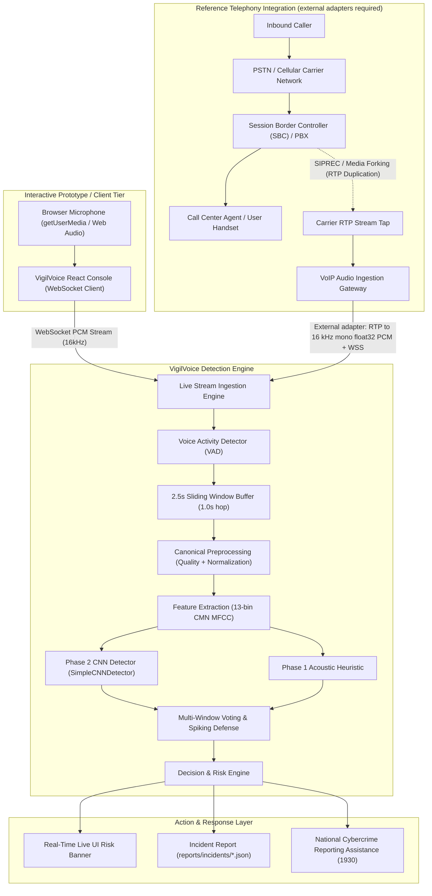
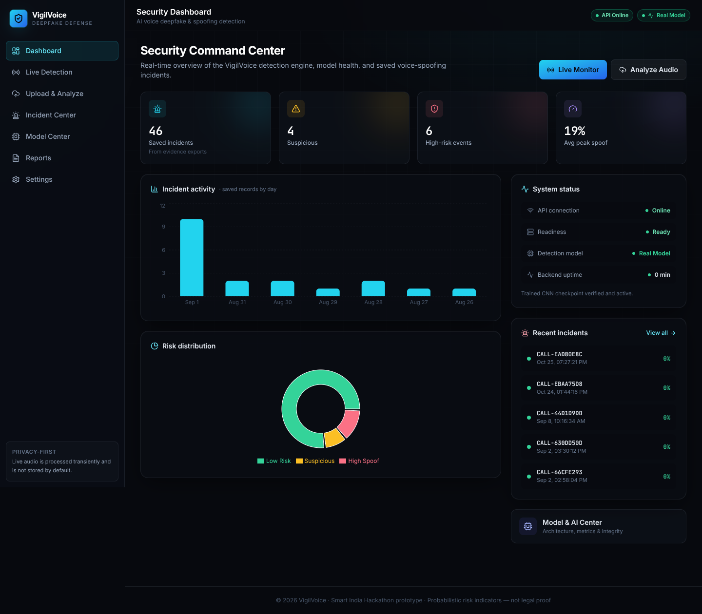
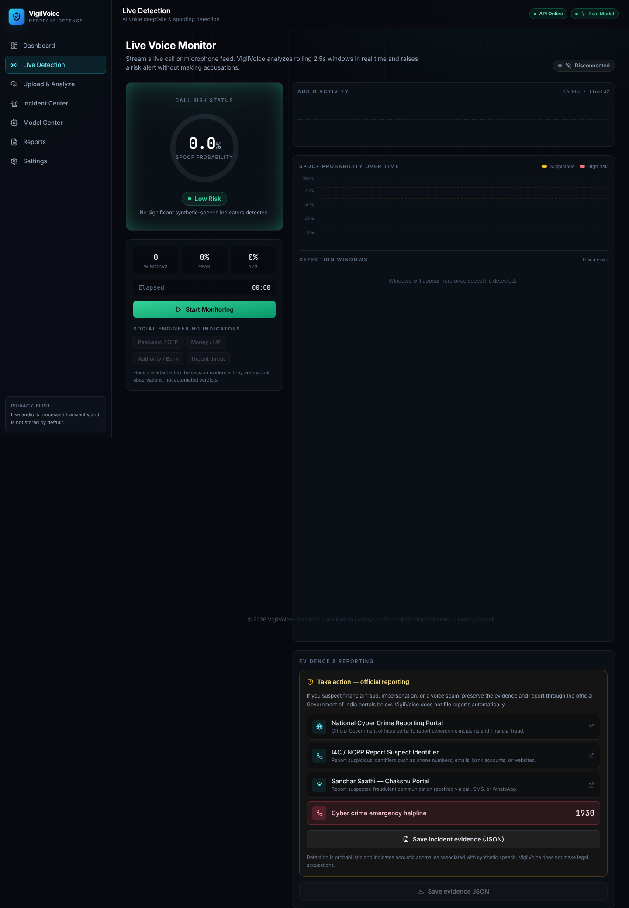

# VigilVoice - AI Audio Deepfake & Spoofing Detection Dashboard

[](https://github.com/Abhi-Jha-18/vigil-voice/actions/workflows/ci.yml)
[](LICENSE)
[](https://www.python.org/downloads/)

VigilVoice is an advanced, real-time audio analysis and security engine designed to detect synthetic voice clones, AI-generated speech, and audio spoofing attacks. Developed as an enterprise-grade defense prototype for Smart India Hackathon (SIH) cybersecurity challenges.

---

## 🚀 Key Features

* **Dual Capture & Live Microphone Terminal**: Upload audio files, record snippets, or stream browser microphone audio over a WebSocket for real-time analysis.
* **Real-Time Sliding Window Spoof Detection**: Evaluates incoming live voice in 2.5s sliding windows (1.0s hop) with rolling multi-window voting and single-spike false alarm protection.
* **Fraud Incident Response & Evidence Export**: Automatically tracks suspicious call episodes, aggregates technical metadata (duration, peak spoof score, model SHA-256), and exports structured evidence JSON (`reports/incidents/{incident_id}.json`).
* **Take Action / Official Reporting Center**: Direct navigation assistance to official Government of India cybercrime portals (CyberCrime Portal, Chakshu, NCRP Suspect Report, National Helpline 1930).
* **Voice Activity Detection (VAD)**: Preprocessing pipeline filters silence out of signals to isolate voice syllables using energy-based voice activity clipping.
* **Spectrogram Feature Mapping**: Generates a high-resolution, colorized Mel-frequency power spectrogram on the fly and visualizes it inside the dashboard.
* **Acoustic Analytics**: Extracts statistical MFCCs, Spectral Centroid, Spectral Roll-off, and Zero Crossing Rates.
* **Presentation Injection (SIH Demo Mode)**: Enables presenters to seamlessly inject custom verdicts (`REAL`, `FAKE`, `UNCERTAIN`) for live presentations and slide demonstrations.

---

## 📂 Project Structure

```text
VigilVoice/
│
├── backend/
│   ├── main.py                # FastAPI app endpoints, WebSockets & static asset mounts
│   ├── config.py              # Centralized environment settings & runtime options
│   │
│   ├── audio/
│   │   ├── config.py          # PreprocessingConfig & default settings
│   │   ├── pipeline.py        # Canonical audio preprocessing & segmentation pipeline
│   │   ├── processor.py       # Audio validation, loading, resampling & normalization
│   │   ├── vad.py             # Voice Activity Detection (silence clipper)
│   │   ├── quality.py         # Audio quality assurance checks (duration, silence, clipping)
│   │   └── features.py        # Mel spectrogram plotter & MFCC extractor
│   │
│   ├── detection/
│   │   ├── detector.py        # AI classification logic (heuristic stub & CNN model)
│   │   ├── decision.py        # Decision boundaries, confidence scoring & risk tiers
│   │   ├── aggregator.py      # Multi-segment probability aggregation strategies
│   │   ├── explainability.py  # Evidence extraction & acoustic cue highlights
│   │   └── risk.py            # Financial and security risk level assessment engine
│   │
│   └── utils/
│       └── audio_utils.py     # Upload and cache file helper utilities
│
├── training/
│   ├── prepare_dataset.py     # Report-generating variant of the dataset preparation CLI
│   ├── benchmark.py           # Latency benchmarking & performance profiling suite
│   ├── load_test.py           # Concurrency and endpoint stress testing tool
│   ├── train.py               # Production CNN training loop with class imbalance weighting
│   ├── evaluate.py            # Evaluation: EER, ROC-AUC, seen vs. unseen attack analysis
│   ├── preprocessing.py       # Thin training wrapper over backend canonical pipeline
│   ├── splits.py              # Speaker-disjoint & generator-disjoint split creation
│   ├── dataset.py             # PyTorch AntiSpoofDataset & metadata validation
│   ├── robustness.py          # Adversarial transformation suite (Noise, Codec, Reverb)
│   └── metrics.py             # EER, ROC-AUC, FAR/FRR, and threshold calculation
│
├── models/
│   └── README.md              # Checkpoint repository details and LFS instructions
│
├── data/
│   ├── prepare.py             # Canonical CLI for dataset validation & split generation
│   ├── metadata.csv           # File labels indexing spreadsheet
│   ├── raw/                   # Unprocessed audio samples (fixtures/real data)
│   └── splits/                # Generated split manifests (manifest.csv)
│
├── tests/                     # Automated suite (106 tests, including Phases 11–16)
│
├── frontend/                  # React + Vite + Tailwind frontend (source)
│   ├── src/
│   │   ├── components/        # Layout, dashboard, timeline, risk radar, audio player
│   │   ├── pages/             # Dashboard, LiveDetection, UploadAnalysis, Incidents, etc.
│   │   ├── hooks/             # useLiveDetection, useModelStatus, useIncidents
│   │   └── services/          # api.js (REST), websocket.js
│   ├── package.json
│   ├── vite.config.js         # Builds into ../static; proxies /api in dev
│   └── tailwind.config.js
│
├── static/                    # Build output — generated by `npm run build`
│   ├── index.html             # Production SPA entry
│   └── assets/                # Bundled JS/CSS/font assets
│
├── .github/
│   └── workflows/
│       └── ci.yml             # GitHub Actions CI workflow (tests & frontend build)
│
├── requirements.txt           # Python dependencies pinned for Python 3.11.x
├── LICENSE                    # MIT License
├── pytest.ini                 # Pytest configuration
├── conftest.py                # Pytest root configuration
└── README.md                  # Comprehensive documentation manual
```

---

## 🛠️ Installation & Setup

1. **Prerequisites**: Install **Python 3.11.x only** (the pinned PyTorch CPU and audio stack is tested on 3.11, not 3.12 or 3.13) and **Node.js 18+**.
2. **Clone the repository** and navigate to the project directory:
   ```bash
   git clone https://github.com/Abhi-Jha-18/vigil-voice.git
   cd vigil-voice
   ```

> [!WARNING]
> **Demo synthetic data must not be used to report anti-spoofing performance.**
> The demo data inside `data/raw` is for architectural demonstrations only. 
> To train the actual model, you MUST manually supply a legitimate dataset (such as ASVspoof).

```bash
# 1. Create a virtual environment
python -m venv .venv

# 2. Activate it
# On Windows:
.venv\Scripts\activate
# On Linux/macOS:
source .venv/bin/activate

# 3. Install dependencies
pip install -r requirements.txt
```

`requirements.txt` pins the CPU-only PyTorch wheel from the official PyTorch CPU index. It is intentionally a CPU development environment; CUDA is not installed or assumed.

### Dataset preparation (optional)

After supplying licensed audio and completing `data/metadata.csv`, run the canonical preparation CLI from the repository root:

```bash
python data/prepare.py
```

This validates the dataset and writes `data/splits/manifest.csv`. The tree also includes `training/prepare_dataset.py`, a variant that additionally writes JSON validation and dataset-statistics reports.

### Windows audio decoding

WAV is the most portable input format. MP3, M4A, AAC, and WebM decoding may require FFmpeg to be installed and available on `PATH`, depending on the codecs in the uploaded file and the local audio backend. Install an FFmpeg build for Windows, add its `bin` directory to `PATH`, then open a new PowerShell window and verify:

```powershell
ffmpeg -version
```

For a custom local configuration, copy `.env.example` to `.env` and set the desired values. Environment variables are read at startup. Relative `MODEL_PATH` values are always resolved from the repository root.

---

## 🖥️ Running the Application

The user interface is a **React + Vite + Tailwind** app in `frontend/`. Vite builds it directly into `static/`, which FastAPI serves (no separate web server or second container required).

### Build the frontend (required before running the backend)
```bash
cd frontend
npm install
npm run build        # emits the production SPA into ../static
cd ..
```

### Frontend development (hot reload)
```bash
# Terminal 1 — FastAPI backend
python -m uvicorn backend.main:app --reload --port 8000

# Terminal 2 — Vite dev server (proxies /api and WebSockets to :8000)
cd frontend
npm run dev          # http://localhost:5173
```
Vite is configured to proxy `/api` (REST **and** WebSocket) to the backend, so no CORS changes are needed during development. Set `VITE_PROXY_TARGET` to point at a different backend host if required.

### Backend development run (serves the built UI in static/)
```bash
python -m uvicorn backend.main:app --reload --port 8000
```

### Production Hardened Run
```bash
ENVIRONMENT=production python -m uvicorn backend.main:app --host 0.0.0.0 --port 8000 --workers 1
```

### Docker Container Deployment
```bash
# Build and run using Docker Compose
docker-compose up -d --build

# Or build standalone image
docker build -t vigilvoice-api .
docker run -p 8000:8000 vigilvoice-api
```

Once started, open your web browser and navigate to:
👉 **[http://127.0.0.1:8000](http://127.0.0.1:8000)**

### API Health & Readiness Probes
- `GET /api/health`: Liveness probe for containers and load-balancers.
- `GET /api/ready`: Readiness probe verifying runtime capability and model integrity state.

---

## 🏗️ System Architecture & Telephony Deployment

> [!IMPORTANT]
> **Browser Microphone Capture vs. Phone-Call Interception:**
> The live terminal captures the client's microphone with `getUserMedia` / Web Audio APIs. It **does not intercept or wiretap cellular, PSTN, or GSM phone calls**.
> The telephony path below is a **reference deployment**, not a bundled SIPREC/PBX connector. A production integrator must obtain lawful consent, fork media at an SBC/PBX, and adapt RTP to the 16 kHz mono float32 PCM WebSocket ingested by VigilVoice.



---

## ⏱️ Segment Lengths & Sliding Windows (Canonical Values)

VigilVoice uses specific, standardized segment lengths tailored to each operational context:

| Context | Window Duration | Overlap / Hop | Source / Implementation | Purpose |
| :--- | :--- | :--- | :--- | :--- |
| **Canonical Preprocessing** | **3.0 s** | **1.0 s overlap (2.0 s hop)** | `backend/audio/config.py` (`PreprocessingConfig`) | File ingestion, training, validation, and offline feature extraction |
| **Server Configuration Value** | **4.0 s** | **1.0 s overlap** | `backend/config.py` (`load_settings`) | Default returned by `/api/status`; configurable with `SEGMENT_DURATION_SECONDS`, but does not override the canonical config above |
| **Live Microphone Stream** | **2.5 s** | **1.0 s hop (1.5 s overlap)** | `backend/config.py` and `backend/api/live.py` (`LiveSession`) | Real-time sliding-window analysis over WebSockets |

---

## 📋 Model Card: VigilVoice CNN Detector

### Overview and Intended Use
- **Architecture:** `SimpleCNNDetector` (Phase 2), a 2D CNN for acoustic spoof detection. Phase 1 is a separate acoustic heuristic; Phases 3 and 4 are architecture stubs, not additional trained models.
- **Input:** 13 MFCC coefficients with Cepstral Mean Normalization (CMN), cropped to 64 time steps (`(1, 13, 64)`) from 16 kHz mono audio.
- **Output:** A sigmoid score estimating $P(\text{bonafide}) \in [0, 1]$, followed by thresholding and risk aggregation.
- **Intended use:** Research and defensive decision support. Scores are probabilistic indicators, not proof of identity, fraud, or legal culpability.

### Data and Evaluation Protocol
- Checkpoint metadata identifies the training data as `ASVSpoof2019_LA_VigilVoice`. The source corpus and complete original training/evaluation audio are not bundled, so that provenance and the metadata's training metrics cannot be independently reproduced from this checkout.
- `data/metadata.csv` and the generated demo audio are **synthetic demonstration data, not valid anti-spoofing benchmark data**.
- `training/splits.py` supports speaker-disjoint and generator-disjoint assignments. For a meaningful unseen-attack result, evaluate generators held out from training in `test_unseen` (or an equivalent generator-disjoint split) and publish the manifest, sample counts, and per-attack metrics.

### Metrics in the Bundled Reports
Sources: `training/runs/evaluation_report.json` and `training/runs/attack_type_results.json`. The report contains four test samples: two bona fide and two TTS attacks. Attack accuracy below is measured on the attack samples; EER also uses the two bona fide samples.

| Evaluation Slice | Attack Samples | Attack Accuracy | EER | Slice ROC-AUC |
| :--- | :---: | :---: | :---: | :---: |
| **Seen/known TTS attack slice** | 2 | 100% | 0.0% | Not separately reported |
| **Unseen attack generators** | 0 | Not evaluated | Not evaluated | Not evaluated |

The overall four-sample report records accuracy **100%**, EER **0.0%**, ROC-AUC **1.000**, FAR **0.0%**, and FRR **0.0%**. **This tiny report is a regression artifact, not reliable evidence of real-world or unseen-attack performance.** No generator-disjoint unseen benchmark is included; such metrics must be measured rather than inferred from this result.

### Known Failure Modes
1. **Novel synthesis and replay attacks:** Generalization to unseen generators is unverified; new vocoders, diffusion models, voice conversion, and replay chains can be missed.
2. **Noise and channel shift:** The bundled four-sample robustness report shows false accepts under tested noise conditions. Low SNR, telephony codecs, resampling, and reverberation can remove discriminative cues or degrade VAD.
3. **Overlapping speakers:** The pipeline has no speaker diarization, so a real and synthetic speaker on one channel can contaminate each other's scores.
4. **Fallback behavior:** Heuristic-only operation does not have the same behavior or validation profile as CNN operation; an unavailable or integrity-failed checkpoint must not be treated as equivalent detection capability.

---

## 🔒 Privacy, Consent, and India's DPDP Act (2023)

VigilVoice includes privacy-minded defaults relevant to deployments subject to India's **Digital Personal Data Protection (DPDP) Act, 2023**. This is not a compliance certification or legal advice: the deployer must establish a lawful basis, provide required notices, honor data-principal rights, and define retention and security procedures.

1. **No persistent raw-audio storage by default:** Live PCM is processed in memory. Uploaded files are written to unpredictably named temporary files for decoding and deleted after analysis; they are not copied into the incident store. Operators should secure the system temporary directory and account for crash/OS cleanup behavior.
2. **Consent and lawful monitoring:** Browser microphone permission authorizes only that browser capture. It is not consent to intercept a phone call. Before monitoring or forking a call, obtain valid consent from required participants and provide clear notices under applicable law and organizational policy.
3. **Incident metadata:** Exported `reports/incidents/{incident_id}.json` files contain timestamps, session/incident IDs, duration, risk scores, model status/SHA-256, and manually selected social-engineering flags. They do not contain raw waveforms, spectrograms, voiceprints, or transcripts. Protect these records as potentially linkable personal/security data and apply an appropriate retention policy.
4. **Defensive use only:** Do not use VigilVoice for covert or unauthorized interception. Production telephony adapters additionally need authenticated transport, access control, audit logging, and consent handling.

---

## ⚠️ Limitations

* **Not a phone-call interceptor:** The included live UI captures browser microphone audio. Real call monitoring requires the external, lawfully deployed telephony adapter shown above.
* **Limited evaluation evidence:** The bundled evaluation has only four samples and no unseen-generator result. It does not establish production accuracy across languages, speakers, attacks, or codecs.
* **Short and degraded audio:** Clips shorter than 0.25 seconds are rejected. Noise, reverberation, faulty microphones, narrowband codecs, and resampling can reduce confidence or cause errors.
* **Overlapping speakers:** No speaker diarization is included; overlapping bona fide and synthetic speech cannot be reliably attributed to a speaker.
* **Probabilistic decisions:** False accepts and false rejects remain possible. Use an independent verification channel for consequential actions rather than blocking payments or accusing a person solely from a score.
* **Demo overrides:** When `DEMO_MODE` is enabled, forced verdicts intentionally bypass genuine inference for presentations. Keep it disabled for real monitoring.
* **Live-session scaling:** Active live sessions are process-local. Multiple workers require sticky routing or shared session state; incident JSON storage also needs an appropriate production retention and access-control policy.

---

## ⚡ Performance Benchmarking & Load Testing

Run the performance profiling script to measure model loading latency, preprocessing time, feature extraction, and neural inference percentiles:

```bash
python training/benchmark.py --iterations 25
```

Run the concurrency load testing tool:

```bash
python training/load_test.py --requests 20 --concurrency 5
```

---

## 🧪 Testing the Audio Pipeline

Ensure all audio analysis, security validations, and ML pipelines function properly by executing the automated test suite:

```bash
pytest tests/ -v
```

This runs all **106 automated unit, integration, and security tests**, including the phase-specific suites for Phases 11 through 16 and the fixed real/fake AUC regression gate.

---

## 📦 Model Checkpoint Storage Policy (Releases / Git LFS)

> [!CAUTION]
> **Do NOT commit new large model checkpoints to the Git repository.**
> Large model weights (`*.pth`, `*.pt`, `*.onnx`, `*.bin`) permanently inflate Git history and slow clones.
> - Publish production weights as **GitHub Releases** assets, or track them with **Git LFS** (for example, `git lfs track "*.pth"`) before adding them.
> - Commit only small metadata, metrics, and SHA-256 manifests alongside the code; document the exact artifact version and download location.

---

## 📸 Screenshots

| Security dashboard | Live browser-microphone monitor |
| :---: | :---: |
|  |  |

---

## 💡 SIH Presentation Mode

For live presentations to reviewers where you need to showcase both authentic and deepfake examples reliably:
1. Open the UI.
2. Under **Demo Simulation Injection (SIH Presentation Mode)** on the left panel, select:
   * **Force REAL**: Guarantees a high-confidence, green-colored `REAL` verdict.
   * **Force FAKE**: Guarantees a high-risk, red-colored `FAKE` warning verdict.
3. Upload or record your audio and click **Run AI Detection Engine**. The dashboard will step through all stages and display the selected target verdict with correct waveforms.

---

## 📄 License

This project is licensed under the MIT License - see the [LICENSE](LICENSE) file for details.
