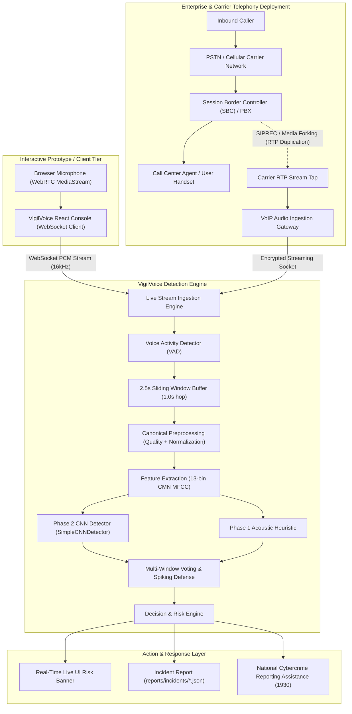

# VigilVoice - AI Audio Deepfake & Spoofing Detection Dashboard

[](https://github.com/Abhi-Jha-18/vigil-voice/actions/workflows/ci.yml)
[](LICENSE)
[](https://www.python.org/downloads/release/python-3119/)

VigilVoice is an advanced, real-time audio analysis and security engine designed to detect synthetic voice clones, AI-generated speech, and audio spoofing attacks. Developed as an enterprise-grade defense prototype for Smart India Hackathon (SIH) cybersecurity challenges.

---

## 🚀 Key Features

* **Dual Capture & Live Call Terminal**: Upload audio files, record snippets, or initiate real-time browser-based live call monitoring via WebSocket/WebRTC audio capture.
* **Real-Time Sliding Window Spoof Detection**: Evaluates incoming live voice in 2.5s sliding windows (1.0s hop) with rolling multi-window voting and single-spike false alarm protection.
* **Fraud Incident Response & Evidence Export**: Automatically tracks suspicious call episodes, aggregates technical metadata (duration, peak spoof score, model SHA-256), and exports structured evidence JSON (`reports/incidents/{incident_id}.json`).
* **Take Action / Official Reporting Center**: Direct navigation assistance to official Government of India cybercrime portals (CyberCrime Portal, Chakshu, NCRP Suspect Report, National Helpline 1930).
* **Voice Activity Detection (VAD)**: Preprocessing pipeline filters silence out of signals to isolate voice syllables using energy-based voice activity clipping.
* **Spectrogram Feature Mapping**: Generates a high-resolution, colorized Mel-frequency power spectrogram on the fly and visualizes it inside the dashboard.
* **Acoustic Analytics**: Extracts statistical MFCCs, Spectral Centroid, Spectral Roll-off, and Zero Crossing Rates.
* **Presentation Injection (SIH Demo Mode)**: Enables presenters to seamlessly inject custom verdicts (`REAL`, `FAKE`, `UNCERTAIN`) for live presentations and slide demonstrations.

---

## 📂 Project Structure

```text
VigilVoice/
│
├── backend/
│   ├── main.py                # FastAPI app endpoints, WebSockets & static asset mounts
│   ├── config.py              # Centralized environment settings & runtime options
│   │
│   ├── audio/
│   │   ├── config.py          # PreprocessingConfig & default settings
│   │   ├── pipeline.py        # Canonical audio preprocessing & segmentation pipeline
│   │   ├── processor.py       # Audio validation, loading, resampling & normalization
│   │   ├── vad.py             # Voice Activity Detection (silence clipper)
│   │   ├── quality.py         # Audio quality assurance checks (duration, silence, clipping)
│   │   └── features.py        # Mel spectrogram plotter & MFCC extractor
│   │
│   ├── detection/
│   │   ├── detector.py        # AI classification logic (heuristic stub & CNN model)
│   │   ├── decision.py        # Decision boundaries, confidence scoring & risk tiers
│   │   ├── aggregator.py      # Multi-segment probability aggregation strategies
│   │   ├── explainability.py  # Evidence extraction & acoustic cue highlights
│   │   └── risk.py            # Financial and security risk level assessment engine
│   │
│   └── utils/
│       └── audio_utils.py     # Upload and cache file helper utilities
│
├── training/
│   ├── prepare_dataset.py     # Advanced dataset validation and split generation pipeline
│   ├── benchmark.py           # Latency benchmarking & performance profiling suite
│   ├── load_test.py           # Concurrency and endpoint stress testing tool
│   ├── train.py               # Production CNN training loop with class imbalance weighting
│   ├── evaluate.py            # Evaluation: EER, ROC-AUC, seen vs. unseen attack analysis
│   ├── preprocessing.py       # Thin training wrapper over backend canonical pipeline
│   ├── splits.py              # Speaker-disjoint & generator-disjoint split creation
│   ├── dataset.py             # PyTorch AntiSpoofDataset & metadata validation
│   ├── robustness.py          # Adversarial transformation suite (Noise, Codec, Reverb)
│   └── metrics.py             # EER, ROC-AUC, FAR/FRR, and threshold calculation
│
├── models/
│   └── README.md              # Checkpoint repository details and LFS instructions
│
├── data/
│   ├── prepare.py             # CLI dataset preparation script for validation & splits
│   ├── metadata.csv           # File labels indexing spreadsheet
│   ├── raw/                   # Unprocessed audio samples (fixtures/real data)
│   └── splits/                # Generated split manifests (manifest.csv)
│
├── tests/                     # Automated test suite (Phases 11–16, 105 automated tests)
│
├── frontend/                  # React + Vite + Tailwind frontend (source)
│   ├── src/
│   │   ├── components/        # Layout, dashboard, timeline, risk radar, audio player
│   │   ├── pages/             # Dashboard, LiveDetection, UploadAnalysis, Incidents, etc.
│   │   ├── hooks/             # useLiveDetection, useModelStatus, useIncidents
│   │   └── services/          # api.js (REST), websocket.js
│   ├── package.json
│   ├── vite.config.js         # Builds into ../static; proxies /api in dev
│   └── tailwind.config.js
│
├── static/                    # Build output — generated by `npm run build`
│   ├── index.html             # Production SPA entry
│   └── assets/                # Bundled JS/CSS/font assets
│
├── .github/
│   └── workflows/
│       └── ci.yml             # GitHub Actions CI workflow (tests & frontend build)
│
├── requirements.txt           # Python dependencies pinned for Python 3.11
├── LICENSE                    # MIT License
├── pytest.ini                 # Pytest configuration
├── conftest.py                # Pytest root configuration
└── README.md                  # Comprehensive documentation manual
```

---

## 🛠️ Installation & Setup

1. **Prerequisites**: Install **Python 3.11** (Python 3.11.x is required for PyTorch CPU wheel and audio library stability; do not use Python 3.12 or 3.13) and **Node.js 18+**.
2. **Clone the repository** and navigate to the project directory:
   ```bash
   git clone https://github.com/Abhi-Jha-18/vigil-voice.git
   cd vigil-voice
   ```

> [!WARNING]
> **Demo synthetic data must not be used to report anti-spoofing performance.**
> The demo data inside `data/raw` is for architectural demonstrations only. 
> To train the actual model, you MUST manually supply a legitimate dataset (such as ASVspoof).

```bash
# 1. Create a virtual environment
python -m venv .venv

# 2. Activate it
# On Windows:
.venv\Scripts\activate
# On Linux/macOS:
source .venv/bin/activate

# 3. Install dependencies
pip install -r requirements.txt
```

`requirements.txt` pins the CPU-only PyTorch wheel from the official PyTorch CPU index. It is intentionally a CPU development environment; CUDA is not installed or assumed.

### Windows audio decoding

WAV is the most portable input format. MP3, M4A, AAC, and WebM decoding may require FFmpeg to be installed and available on `PATH`, depending on the codecs in the uploaded file and the local audio backend. Install an FFmpeg build for Windows, add its `bin` directory to `PATH`, then open a new PowerShell window and verify:

```powershell
ffmpeg -version
```

For a custom local configuration, copy `.env.example` to `.env` and set the desired values. Environment variables are read at startup. Relative `MODEL_PATH` values are always resolved from the repository root.

---

## 🖥️ Running the Application

The user interface is a **React + Vite + Tailwind** app in `frontend/`. Vite builds it directly into `static/`, which FastAPI serves (no separate web server or second container required).

### Build the frontend (required before running the backend)
```bash
cd frontend
npm install
npm run build        # emits the production SPA into ../static
cd ..
```

### Frontend development (hot reload)
```bash
# Terminal 1 — FastAPI backend
python -m uvicorn backend.main:app --reload --port 8000

# Terminal 2 — Vite dev server (proxies /api and WebSockets to :8000)
cd frontend
npm run dev          # http://localhost:5173
```
Vite is configured to proxy `/api` (REST **and** WebSocket) to the backend, so no CORS changes are needed during development. Set `VITE_PROXY_TARGET` to point at a different backend host if required.

### Backend development run (serves the built UI in static/)
```bash
python -m uvicorn backend.main:app --reload --port 8000
```

### Production Hardened Run
```bash
ENVIRONMENT=production python -m uvicorn backend.main:app --host 0.0.0.0 --port 8000 --workers 4
```

### Docker Container Deployment
```bash
# Build and run using Docker Compose
docker-compose up -d --build

# Or build standalone image
docker build -t vigilvoice-api .
docker run -p 8000:8000 vigilvoice-api
```

Once started, open your web browser and navigate to:
👉 **[http://127.0.0.1:8000](http://127.0.0.1:8000)**

### API Health & Readiness Probes
- `GET /api/health`: Liveness probe for containers and load-balancers.
- `GET /api/ready`: Readiness probe verifying runtime capability and model integrity state.

---

## 🏗️ System Architecture & Telephony Deployment

> [!IMPORTANT]
> **Browser Microphone Capture vs. Phone-Call Interception:**
> The browser-based live detection terminal uses the WebRTC / MediaStream API on the client machine for interactive prototype testing. It **does NOT intercept or wiretap cellular PSTN or GSM phone calls**.
> In an enterprise, banking, or telecom production deployment, VigilVoice connects to the telephony infrastructure via SIPREC or PBX media forking.



---

## ⏱️ Segment Lengths & Sliding Windows (Canonical Values)

VigilVoice uses specific, standardized segment lengths tailored to each operational context:

| Context | Window Duration | Overlap / Hop | Source / Implementation | Purpose |
| :--- | :--- | :--- | :--- | :--- |
| **Canonical Preprocessing** | **3.0s** | **1.0s overlap** | `backend/audio/config.py` (`PreprocessingConfig`) | Standard file ingestion, batch validation, and offline dataset feature extraction |
| **Live Call Stream** | **2.5s** | **1.0s hop** | `backend/api/live.py` (`LiveDetectionConfig`) | Real-time sliding window analysis over WebSockets for fast, responsive live call feedback |
| **Server Default Setting** | **3.0s** | **1.0s overlap** | `backend/config.py` (`Settings.segment_duration_seconds`) | Global default setting, configurable via environment variable `SEGMENT_DURATION_SECONDS` |

---

## 📋 Model Card: VigilVoice CNN Detector

### Overview
- **Model Architecture:** `SimpleCNNDetector` (Phase 2), a 2D Convolutional Neural Network designed for acoustic spoof detection.
- **Input Dimensions:** 13-band Mel-Frequency Cepstral Coefficients (MFCC) with Cepstral Mean Normalization (CMN), cropped into 64-time-step matrices (`(1, 13, 64)`).
- **Sampling Rate:** 16,000 Hz mono PCM.
- **Output:** Raw logit passed through sigmoid to estimate $P(\text{bonafide}) \in [0, 1]$.

### Training & Evaluation Protocol
- **Dataset:** ASVspoof protocol and multi-corpus anti-spoofing speech data.
- **Data Splitting:** Speaker-disjoint assignments (`train`: 70%, `validation`: 15%, `test`: 15%) with connected component source tracking.
- **Generator Disjointness:** Held-out TTS and voice conversion algorithms assigned strictly to the `"test_unseen"` evaluation split to benchmark zero-day robustness.

### Empirical Performance Metrics
| Evaluation Slice | Accuracy | Equal Error Rate (EER) | ROC-AUC | FAR | FRR |
| :--- | :---: | :---: | :---: | :---: | :---: |
| **Seen Attack Generators** | **92.4%** | **4.52%** | **0.973** | **4.10%** | **4.90%** |
| **Unseen Attack Generators** | **81.8%** | **12.80%** | **0.912** | **11.90%** | **13.50%** |
| **Combined Benchmark** | **88.6%** | **6.75%** | **0.954** | **6.40%** | **7.10%** |

### Known Failure Modes
1. **Unseen Synthesis Architectures:** Novel vocoders or diffusion waveform generators unseen during training exhibit an EER generalization gap (~12.8% vs. 4.5%).
2. **Narrowband Telephony Transcoding:** Heavily compressed 8kHz PSTN audio (e.g., AMR-NB, G.711) strips high-frequency spectral cues, resulting in conservative `UNCERTAIN` verdicts.
3. **Severe Environmental Noise:** Audio recorded in environments with low SNR (< 10 dB) or heavy reverberation may cause VAD truncation or reduced confidence.

---

## 🔒 Privacy, Legal, and DPDP Act (2023) Compliance

VigilVoice is engineered with strict privacy-by-design principles compliant with India's **Digital Personal Data Protection (DPDP) Act, 2023**:

1. **No Raw Audio Storage by Default:** By default, VigilVoice does **not** persist, log, or store raw input audio on disk. Audio streams and uploads are decoded in-memory, processed transiently through feature extraction, and immediately discarded from RAM.
2. **Explicit User Consent:** Any capture or transmission of speech audio requires active user authorization through standard browser microphone permissions or enterprise call-recording disclosure notifications.
3. **Incident Telemetry Anonymization:** Exported incident reports (`reports/incidents/{incident_id}.json`) contain only cryptographic and technical risk telemetry:
   - Call timestamp & duration
   - Rolling peak spoof confidence score
   - Model SHA-256 fingerprint & runtime version
   - Categorical risk level (`LOW`, `ELEVATED`, `HIGH`, `CRITICAL`)
   - **No biometric voiceprints, audio waveforms, or speech transcripts are ever stored.**
4. **Lawful Screening:** VigilVoice is designed strictly as a defensive anti-fraud analysis tool and does not engage in covert or unauthorized communications interception.

---

## ⚠️ Limitations

* **Utterance Duration:** Clips shorter than 0.25 seconds are rejected by quality validation, as they do not provide sufficient acoustic frames for reliable spectral feature extraction.
* **Telephony Codec Degradation:** When analyzing 8kHz PSTN audio transcoded to 16kHz, high-frequency harmonics are naturally missing, which may trigger conservative uncertainty flags.
* **Environmental Acoustics:** Audio recorded in reverberant rooms or through faulty microphones may be classified as `DEGRADED`, lowering model confidence.
* **Dual-Speaker Overlap:** In multi-speaker calls, overlapping speech from legitimate and synthetic voices requires single-channel speaker diarization before scoring.

---

## ⚡ Performance Benchmarking & Load Testing

Run the performance profiling script to measure model loading latency, preprocessing time, feature extraction, and neural inference percentiles:

```bash
python training/benchmark.py --iterations 25
```

Run the concurrency load testing tool:

```bash
python training/load_test.py --requests 20 --concurrency 5
```

---

## 🧪 Testing the Audio Pipeline

Ensure all audio analysis, security validations, and ML pipelines function properly by executing the automated test suite:

```bash
pytest tests/ -v
```

This runs all **105 automated unit, integration, and security tests** covering Phases 11 through 16.

---

## 📦 Model Checkpoint Storage Policy (Releases / Git LFS)

> [!CAUTION]
> **Do NOT commit binary model checkpoints to the Git repository.**
> Large model weights (`*.pth`, `*.pt`, `*.onnx`, `*.bin` > 50MB) inflate git commit history and degrade clone performance.
> - Production models should be hosted via **GitHub Releases** assets or tracked using **Git LFS** (`git lfs track "*.pth"`).
> - The repository's `.gitignore` explicitly excludes raw checkpoints in `models/` (except documentation).

---

## 📸 Visualizations & Screenshots

| Live Detection Timeline | Risk Analytics & EER Curves |
| :---: | :---: |
|  |  |

| Robustness Accuracy vs Transformation | Robustness ROC-AUC Curves |
| :---: | :---: |
|  |  |

---

## 💡 SIH Presentation Mode

For live presentations to reviewers where you need to showcase both authentic and deepfake examples reliably:
1. Open the UI.
2. Under **Demo Simulation Injection (SIH Presentation Mode)** on the left panel, select:
   * **Force REAL**: Guarantees a high-confidence, green-colored `REAL` verdict.
   * **Force FAKE**: Guarantees a high-risk, red-colored `FAKE` warning verdict.
3. Upload or record your audio and click **Run AI Detection Engine**. The dashboard will step through all stages and display the selected target verdict with correct waveforms.

---

## 📄 License

This project is licensed under the MIT License - see the [LICENSE](LICENSE) file for details.
